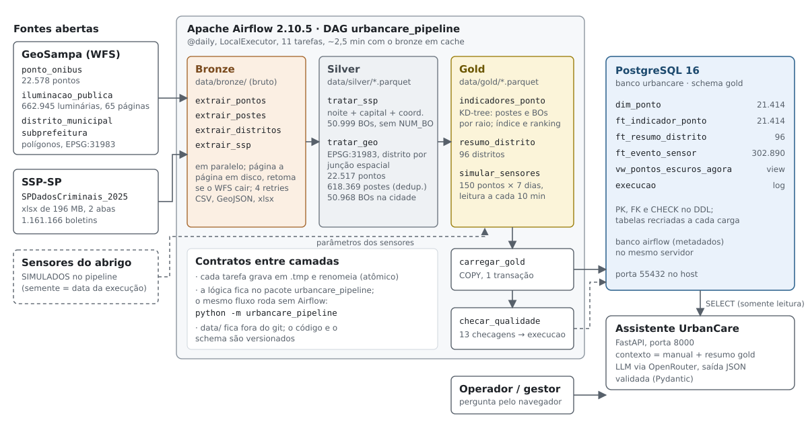
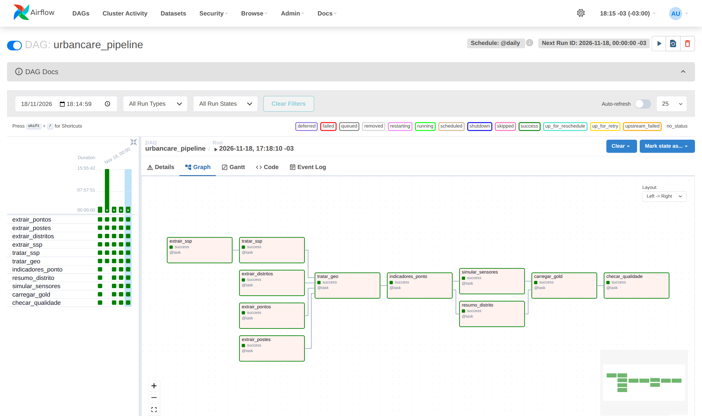
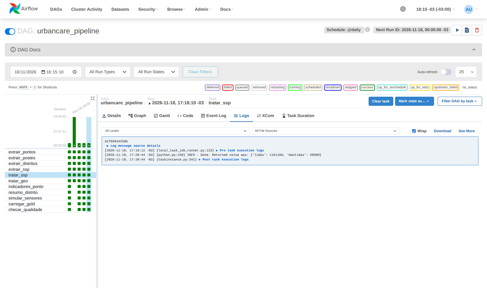
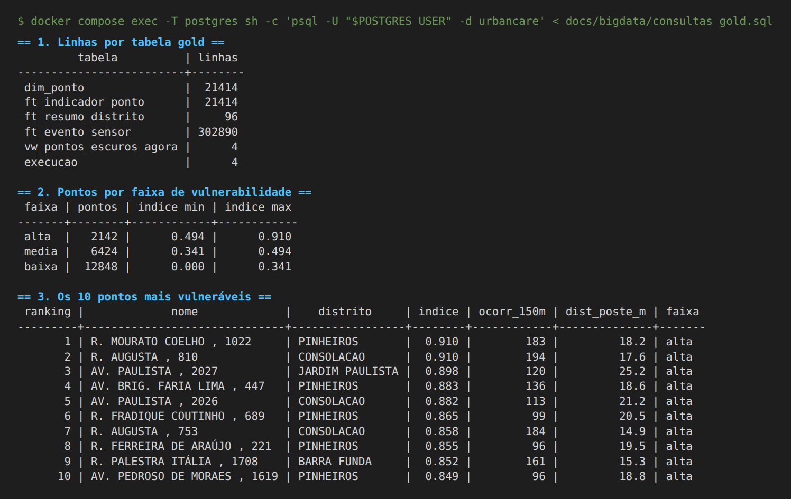
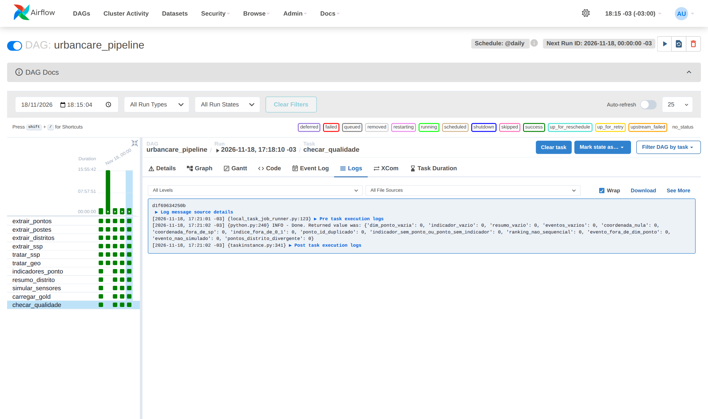
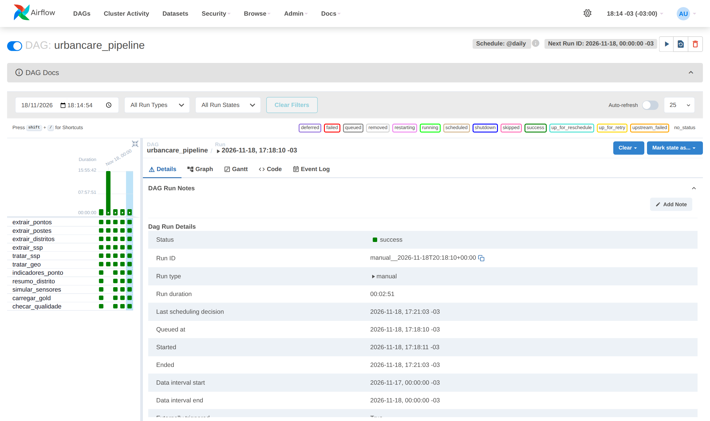
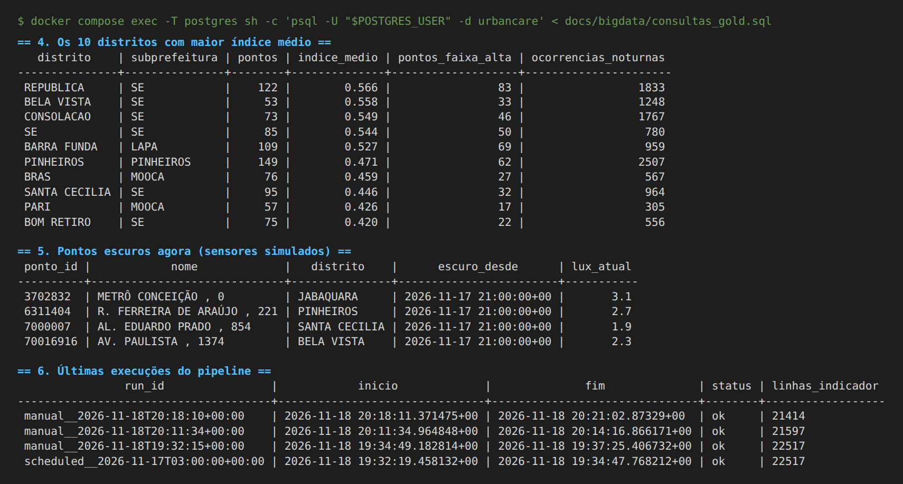

# UrbanCare: pipeline de dados

Entrega de **Big Data Architecture & Data Integration** (Profa. Ana Machado), Global Solution CitizenTech, 2026.

O UrbanCare é um abrigo de ônibus inteligente que protege quem espera à noite, em especial mulheres desacompanhadas, mães com crianças e idosos. Este pipeline responde à pergunta que vem antes da instalação: **em quais dos 22 mil pontos de ônibus de São Paulo o abrigo faz mais diferença?** Ele também entrega as leituras dos sensores do abrigo para a operação.

O pipeline é orquestrado no Airflow e vai do dado bruto ao dado pronto:

- **Fontes:** dados abertos reais do GeoSampa (pontos de ônibus, postes de iluminação e distritos) e da SSP-SP (boletins de ocorrência de 2025).
- **Saída:** o schema `gold` no PostgreSQL, com um índice de vulnerabilidade noturna por ponto, um resumo por distrito e as leituras dos sensores.

O schema `gold` **alimenta de fato o produto**: o [assistente do UrbanCare](../assistente/README.md) lê essas tabelas a cada pergunta do operador.

| Aspecto | Detalhe |
|---|---|
| Orquestração | Apache Airflow 2.10.5 (LocalExecutor), DAG `urbancare_pipeline`, 11 tarefas, `@daily` |
| Armazenamento | `data/bronze` (bruto) → `data/silver` (Parquet) → `data/gold` (Parquet) → PostgreSQL 16, schema `gold` |
| Volume processado | 1.161.166 BOs, 662.945 luminárias, 22.578 pontos de ônibus e 96 distritos por execução |
| Tempo | ~2,5 min com o bronze em cache; o parse do xlsx da SSP leva ~2 min desse total |
| Testes | 54 testes pytest ([saída](../docs/evidencias/pytest_pipeline.txt)) e 13 checagens de qualidade a cada execução |

## 1. Arquitetura



A arquitetura em medalhão tem três camadas, cada uma com um contrato:

- **Bronze:** cópia fiel da fonte, sem nenhuma transformação. Serve de cache e permite reprocessar sem baixar de novo.
- **Silver:** dados limpos, tipados, reprojetados para EPSG:31983 (metros) e já sem identificadores pessoais.
- **Gold:** tabelas de negócio, prontas para consumo e carregadas no Postgres com chaves e restrições.

**Decisões de arquitetura:**

- **A lógica fica no pacote Python `urbancare_pipeline`.** As tarefas do DAG só chamam funções, então o mesmo fluxo roda sem Airflow (`python -m urbancare_pipeline`). Isso facilita os testes e serve de plano B se o Airflow falhar.
- **A escrita é atômica em todas as camadas.**
  - Cada arquivo é gravado em `.tmp` e renomeado; uma execução interrompida nunca deixa um parquet pela metade.
  - A carga no Postgres é uma única transação: ou todas as tabelas gold mudam, ou nenhuma muda.
- **A extração resiste à instabilidade da fonte.** O WFS do GeoSampa oscila (503 e timeout).
  - Cada página de 10.240 registros vai para o disco assim que chega, e uma nova execução retoma da página onde parou.
  - O arquivo final só é montado quando o total confere com o `numberMatched` do servidor.
  - O xlsx da SSP só é baixado de novo se o tamanho remoto mudar.
- **O Postgres sobe com dois bancos.** O banco `airflow` guarda os metadados do orquestrador e o banco `urbancare` guarda os dados. O assistente só faz `SELECT` no schema `gold`.
- **Os dados não vão para o git.** `data/` está no `.gitignore` e o código e o DDL são versionados. Qualquer pessoa recria tudo a partir das fontes abertas.

## 2. Fontes de dados

Todas as fontes foram verificadas em 2026-11-18.

| Fonte | Conteúdo | Acesso | Volume |
|---|---|---|---|
| GeoSampa WFS `geoportal:ponto_onibus` | pontos de ônibus da SPTrans | aberto, sem chave | 22.578 pontos |
| GeoSampa WFS `geoportal:iluminacao_publica` | cadastro de luminárias (carga de 21/10/2026) | aberto, até 10.240 registros por página | 662.945 luminárias em 65 páginas |
| GeoSampa WFS `geoportal:distrito_municipal` e `geoportal:subprefeitura` | polígonos administrativos | aberto | 96 distritos e 32 subprefeituras |
| SSP-SP `SPDadosCriminais_2025.xlsx` | boletins de ocorrência do estado | aberto | 196 MB; abas `JAN-JUN_2025` e `JUL-DEZ_2025`, 1.161.166 linhas |
| **Sensores do abrigo (simulados)** | luminosidade, lotação, pessoa sozinha à noite | gerados no pipeline | 150 pontos × 7 dias |

**Por que simular os sensores:**

- O abrigo ainda não existe fisicamente. A rubrica aceita dados "simulados de forma justificada".
- A simulação usa a meta de instalação do 1º ano do plano de negócio: 150 abrigos.
- Ela é determinística: a semente é a data da execução, e a mesma data gera os mesmos eventos.
- Todo registro sai com `simulado = true`. Nenhum dado de pessoa é gerado: `pessoa_sozinha_noite` é só um contador de alerta, como no Edge AI do produto, que descarta o frame na memória.

## 3. O DAG `urbancare_pipeline`



| Camada | Tarefa | O que faz | Saída |
|---|---|---|---|
| Bronze | `extrair_pontos` | WFS em CSV, paginado e ordenado pela chave | `bronze/geosampa/ponto_onibus.csv` |
| Bronze | `extrair_postes` | WFS em CSV, 65 páginas de 10.240, com retomada | `bronze/geosampa/iluminacao_publica.csv` |
| Bronze | `extrair_distritos` | WFS em GeoJSON | `bronze/geosampa/distritos.geojson`, `subprefeituras.geojson` |
| Bronze | `extrair_ssp` | download do xlsx, com cache pelo tamanho | `bronze/ssp/SPDadosCriminais_2025.xlsx` |
| Silver | `tratar_ssp` | lê as duas abas em streaming (stdlib, sem carregar 196 MB na memória) e filtra | `silver/ocorrencias_noturnas.parquet` |
| Silver | `tratar_geo` | reprojeta, deduplica postes, atribui distrito e recorta os BOs pelo contorno da cidade | `silver/pontos.parquet`, `postes.parquet`, `ocorrencias_geo.parquet` |
| Gold | `indicadores_ponto` | tira os pontos fora do escopo e calcula, por KD-tree, postes e BOs por raio, o índice, o ranking e a faixa | `gold/dim_ponto`, `gold/ft_indicador_ponto` |
| Gold | `resumo_distrito` | agrega por distrito | `gold/ft_resumo_distrito` |
| Gold | `simular_sensores` | leituras de 7 dias até a data da execução | `gold/ft_evento_sensor` |
| Carga | `carregar_gold` | recria as tabelas e faz `COPY` numa única transação | schema `gold` no Postgres |
| Qualidade | `checar_qualidade` | roda 13 checagens; qualquer violação falha a tarefa | `gold.execucao` |

Ordem de execução:

- As quatro extrações rodam em paralelo.
- `tratar_ssp` depende só da SSP.
- `tratar_geo` depende das três extrações do GeoSampa e de `tratar_ssp`.
- Depois vem `indicadores_ponto`.
- Em seguida, `resumo_distrito` e `simular_sensores`, em paralelo.
- Por fim, `carregar_gold` e `checar_qualidade`.

Novas tentativas:

- As extrações têm 4 novas tentativas, com 5 minutos entre elas, por causa da instabilidade da fonte.
- As demais tarefas têm 2.
- `checar_qualidade` não tem nenhuma: se o dado está errado, rodar de novo não resolve.

### 3.1 Tratamento (silver)

| Regra | Onde | Efeito |
|---|---|---|
| `NOME_MUNICIPIO = S.PAULO` | `tratar_ssp` | só a capital |
| `DESC_PERIODO` em {`A noite`, `De madrugada`} | `tratar_ssp` | só ocorrências noturnas; a hora vem nula em 100% das linhas noturnas, então o período é o único recorte possível |
| Latitude e longitude numéricas (aceita vírgula decimal) dentro do retângulo da cidade | `tratar_ssp` | descarta `NULL`, zero, lixo e a linha de rodapé "VEDAÇÃO" |
| `categoria` (roubo, furto ou outros, pela `RUBRICA`) e `transeunte` (pela `DESCR_CONDUTA`) | `tratar_ssp` | atributos usados no gold |
| Descarta `NUM_BO`, delegacia e endereço | `tratar_ssp` | **minimização de dados (LGPD)**: nada no silver aponta para um BO ou uma vítima |
| Reprojeção de WGS84 para EPSG:31983 (SIRGAS 2000 / UTM 23S) | `tratar_geo` | distâncias em metros |
| Luminárias a menos de 0,5 m uma da outra viram um poste | `tratar_geo` | 662.945 luminárias → 618.369 postes (média de 1,07 luminária por poste, máximo de 13) |
| Distrito por junção espacial; um ponto a até 200 m de um distrito (na divisa) recebe o mais próximo | `tratar_geo` | 22.578 → 22.517 pontos (61 fora da cidade ou duplicados) |
| BOs recortados pelo contorno real dos distritos, sem tolerância | `tratar_geo` | 50.999 → 50.968 BOs |



*Linha-chave do log: `Done. Returned value was: {'lidas': 1161166, 'mantidas': 50999}`.*

## 4. Índice de vulnerabilidade noturna

Para cada ponto de ônibus:

```
indice = 0,6 × log(1 + oc) / log(1 + oc_max)  +  0,4 × pct(dist_poste_m)
```

- `oc` = `ocorrencias_noturnas_150m`: BOs noturnos relevantes a até 150 m do ponto, com o teto por coordenada (abaixo). `oc_max` é o maior valor da cidade (295).
- `dist_poste_m`: distância ao poste mais próximo.
- `pct(·)`: percentil de 0 a 1; nos empates, todos recebem o menor posto.
- O índice vai de 0 a 1. Depois dele vem o **ranking** de 1 (mais vulnerável) a 21.414. O desempate é mais ocorrências, depois poste mais distante, depois `ponto_id`, para que o ranking seja estável.
- **Faixas pelo ranking:** **alta** = os 10% mais vulneráveis (2.142 pontos); **média** = os 30% seguintes (6.424); **baixa** = o restante (12.848).

**Quais BOs entram:** a decisão saiu do perfil dos dados ([notas](../docs/bigdata/notas-dados.md)).

| Filtro | Por quê | Dado que motivou |
|---|---|---|
| Só fatos de 2025 | 2% dos BOs de 2025 relatam fatos antigos | 1.033 BOs com data anterior a 2025, a mais antiga de 2006 |
| Só `DESCR_TIPOLOCAL = Via Pública` | o abrigo protege quem está na rua | ~870 furtos dentro dos festivais do autódromo de Interlagos, com local `Outros` |
| Sem condutas contra patrimônio (`Fios e Cabos`, `Veículo`, `Interior de Veículo`, `Carga`) | não são crimes contra o passageiro | 1.739 BOs de fios e cabos e 1.327 de veículo |
| **Teto de 10 BOs por coordenada exata** | amortece pilhas de geocodificação e eventos sem apagar ruas com casos espalhados | 7,9% dos BOs estão em coordenadas com 20 ou mais BOs; o estádio do Morumbi tem 291 furtos em dias de show |

**Pontos fora do escopo:**

- Paradas de terminal (`TERM.`, `TERMINAL`): 920.
- Paradas de corredor ou estação de transferência (`M01 …`, `C09 …`, `E. T. …`): 183.

Restam 21.414 pontos, que são os que vão para `dim_ponto`. O UrbanCare é um abrigo de rua. Essas paradas têm iluminação própria da SPTrans, que não está no cadastro de postes da prefeitura: 40% e 33% delas aparecem com 0 postes a 30 m, contra ~1% das paradas de rua. Elas também têm várias plataformas no mesmo local.

### 4.1 Justificativa dos parâmetros

Os parâmetros são constantes nomeadas em [`gold.py`](urbancare_pipeline/gold.py), [`transform.py`](urbancare_pipeline/transform.py) e [`sensores.py`](urbancare_pipeline/sensores.py), cobertas por testes.

| Parâmetro | Valor | Justificativa |
|---|---|---|
| `PESO_OCORRENCIAS` | 0,6 | o risco observado (crime de rua real) pesa mais que a infraestrutura |
| `PESO_ESCURIDAO` | 0,4 | a escuridão é um agravante, e é o que o UrbanCare consegue mudar (chamado de zeladoria) |
| Escala `log(1+x)/log(1+max)` | — | diferencia o topo sem saturar: com o máximo de 295, 65 BOs → 0,74 e 194 → 0,93. O percentil daria ~0,99 aos dois |
| Escuridão = `pct(dist_poste_m)` | — | é contínua, sem limiar arbitrário; a contagem de postes a 30 m criava um degrau (ver 4.2) |
| `RAIO_OCORRENCIA_M` | 150 m | cobre a imprecisão da geocodificação dos BOs e a caminhada até o ponto |
| `RAIO_POSTE_M` | 30 m | descritivo (`postes_30m`): um poste a até 30 m ilumina o abrigo; não entra no índice |
| `TETO_POR_COORDENADA` | 10 | a partir de 10 BOs na mesma coordenada exata, o mais provável é geocodificação padrão ou evento |
| `FRACAO_ALTA`, `FRACAO_MEDIA` | 10% e 30% | faixas legíveis para o gestor ("entre os 10% mais vulneráveis da cidade"); com cortes fixos e a escala log, só 0,4% dos pontos ficariam na faixa alta |
| `PRECISAO_POSTE_M` | 0,5 m | o cadastro tem uma linha por luminária; braços do mesmo poste ficam a centímetros |
| `TOLERANCIA_DISTRITO_M` | 200 m | pontos na divisa ou na calçada fora do polígono continuam na cidade; BOs não têm tolerância |
| `PONTOS_INSTALADOS` | 150 | meta de abrigos do 1º ano no plano de negócio |
| `DIAS`, `PASSO_MIN` | 7 dias, 10 min | uma semana de operação, com granularidade de painel |
| `LUX_ESCURO` | 10 lux | abaixo disso o abrigo está "escuro" e abre o chamado de zeladoria |
| `FRACAO_APAGAO` | 5% | proporção de abrigos com lâmpada queimada na semana simulada; metade continua apagada até a última leitura |

### 4.2 Como a fórmula chegou aqui: 3 versões com dados reais

O índice passou por três rodadas no mesmo dia, cada uma rodada contra os dados reais. Os top 10 abaixo foram **recalculados a partir do código de cada commit** (`fcfd457`, `58cd19d` e `3975741`) sobre o mesmo silver.

| | v1: spec original | v2: distância ao poste | v3: escala log (final) |
|---|---|---|---|
| Fórmula | `0,6·pct(oc) + 0,4·(1 − pct(postes_30m))` | `0,6·pct(oc) + 0,4·pct(dist_poste_m)` | `0,6·log1p(oc)/log1p(max) + 0,4·pct(dist_poste_m)` |
| Pontos | 22.517 | 21.597 (terminais fora) | 21.414 (terminais e corredores fora) |
| Faixas | cortes fixos 0,75 / 0,5 → alta 3.432 | cortes fixos → alta 2.438 | ranking 10% / 30% → alta 2.142 |
| Problema visto | 8 dos 10 primeiros eram plataformas de terminal com "0 postes a 30 m": a contagem funcionava como degrau | Av. Paulista em 1º e 2º com 65 e 55 BOs; plataformas de corredor no top 10 | — |
| Causa | terminais têm luz própria fora do cadastro; o poste mais próximo estava a 32–44 m, logo depois do corte de 30 m | o percentil satura no topo (65 e 194 BOs valem ~0,99), e entre os pontos de muito crime só a escuridão decidia | — |

**Top 10 de cada versão** (nome do ponto, BOs a 150 m):

| # | v1 | v2 | v3 (final) |
|---|---|---|---|
| 1 | TERM. SANTANA (106) | AV. PAULISTA, 1754 (65) | R. MOURATO COELHO, 1022 (183) |
| 2 | TERM. SANTANA (102) | AV. PAULISTA, 901 (55) | R. AUGUSTA, 810 (194) |
| 3 | TERM. METRÔ TATUAPÉ (68) | M01 CARANDIRU - SANTANA (114) | AV. PAULISTA, 2027 (120) |
| 4 | TERM. METRÔ TATUAPÉ (67) | PQ. D. PEDRO II (47) | AV. BRIG. FARIA LIMA, 447 (136) |
| 5 | AV. PAULISTA, 1754 (65) | AV. PAULISTA, 2027 (120) | AV. PAULISTA, 2026 (113) |
| 6 | TERM. METRÔ TATUAPÉ (63) | M01 ARMÊNIA - PORTUGUESA-TIETÊ (44) | R. FRADIQUE COUTINHO, 689 (99) |
| 7 | TERM. METRÔ TATUAPÉ (59) | E. T. VÍTOR MANZINI (58) | R. AUGUSTA, 753 (184) |
| 8 | TERM. METRÔ TATUAPÉ (59) | AV. SANTOS DUMONT, 87 (41) | R. FERREIRA DE ARAÚJO, 221 (96) |
| 9 | AV. PAULISTA, 901 (55) | R. CANUTO DO VAL, 54 (32) | R. PALESTRA ITÁLIA, 1708 (161) |
| 10 | TERM. METRÔ TATUAPÉ (53) | C11 TATUAPÉ - CORINTHIANS-ITAQUERA (32) | AV. PEDROSO DE MORAES, 1619 (96) |

Na v3, o topo reflete crime de rua real, e a escuridão entra como agravante: o 1º lugar tem 183 BOs a 150 m e o poste mais próximo a 18 m. As três versões também aparecem em `gold.execucao` (22.517 → 21.597 → 21.414 linhas no indicador).

### 4.3 Resultado

| Faixa | Pontos | Índice |
|---|---|---|
| alta | 2.142 | 0,494 a 0,910 |
| média | 6.424 | 0,341 a 0,494 |
| baixa | 12.848 | 0,000 a 0,341 |

Os distritos com maior índice médio são República (0,566), Bela Vista (0,558), Consolação (0,549), Sé (0,544) e Barra Funda (0,527). 5.845 pontos (27%) não têm nenhum BO relevante a 150 m.



## 5. Dicionário de dados (schema `gold`)

Tirado do banco (`information_schema`) após a carga de 2026-11-18. O DDL está em [`load.py`](urbancare_pipeline/load.py). Todas as tabelas são recriadas a cada carga, exceto `execucao`, que acumula o histórico.

**Convenções:**

- Coordenadas `x_31983` e `y_31983` em metros, EPSG:31983 (SIRGAS 2000 / UTM 23S). `lat` e `lon` em graus WGS84.
- `timestamptz` gravado em UTC. A UI do Airflow e o assistente exibem no horário de São Paulo.

### `gold.dim_ponto`: pontos de ônibus no escopo do abrigo (21.414 linhas)

| Coluna | Tipo | Nulo | Descrição | Origem |
|---|---|---|---|---|
| `ponto_id` | text, **PK** | não | código do ponto na SPTrans | GeoSampa `cd_identificador_ponto_onibus` |
| `nome` | text | não | nome do ponto; se vazio, o endereço | `nm_ponto_onibus` |
| `endereco` | text | sim | endereço do ponto | `tx_endereco_ponto_onibus` |
| `distrito` | text | não | distrito municipal (sem acento, maiúsculas) | junção espacial com `distrito_municipal` |
| `subprefeitura` | text | sim | subprefeitura do distrito | `subprefeitura` |
| `x_31983`, `y_31983` | double precision | não | coordenadas em metros | `ge_ponto` |
| `lat`, `lon` | double precision | não | coordenadas em graus | reprojeção de `ge_ponto` |

### `gold.ft_indicador_ponto`: indicadores e índice por ponto (21.414 linhas)

| Coluna | Tipo | Nulo | Descrição | Unidade |
|---|---|---|---|---|
| `ponto_id` | text, **PK**, FK → `dim_ponto` | não | ponto | — |
| `postes_30m` | integer | não | postes a até 30 m (descritivo) | postes |
| `dist_poste_m` | double precision | não | distância ao poste mais próximo (0,1 a 2.394,8; mediana de 10,8) | metros |
| `ocorrencias_noturnas_150m` | integer | não | BOs noturnos relevantes a até 150 m, com teto de 10 por coordenada (0 a 295; média de 3,7) | BOs |
| `roubos_transeunte_150m` | integer | não | subconjunto: roubos com conduta `Transeunte` (descritivo) | BOs |
| `indice_vulnerabilidade` | numeric(5,4) | não | índice da seção 4, entre 0 e 1 | — |
| `faixa` | text, CHECK em {`alta`, `media`, `baixa`} | não | faixa pelo ranking (10% / 30% / 60%) | — |
| `ranking` | integer, UNIQUE | não | 1 = mais vulnerável, até 21.414 | posição |

### `gold.ft_resumo_distrito`: agregado por distrito (96 linhas)

| Coluna | Tipo | Nulo | Descrição |
|---|---|---|---|
| `distrito` | text, **PK** | não | distrito municipal |
| `subprefeitura` | text | sim | subprefeitura |
| `pontos` | integer | não | pontos do distrito em `dim_ponto` |
| `indice_medio` | numeric(5,4) | não | média do `indice_vulnerabilidade` dos pontos |
| `pontos_faixa_alta` | integer | não | pontos do distrito na faixa alta |
| `ocorrencias_noturnas` | integer | não | BOs noturnos relevantes dentro do distrito (sem teto: total do distrito) |

### `gold.ft_evento_sensor`: leituras dos sensores, SIMULADAS (302.890 linhas)

| Coluna | Tipo | Nulo | Descrição |
|---|---|---|---|
| `ponto_id` | text, FK → `dim_ponto` | não | um dos 150 primeiros do ranking |
| `ts` | timestamptz | não | instante da leitura; passo de 10 min, janela de 7 dias até a meia-noite da data da execução |
| `tipo` | text, CHECK | não | `lux` (151.200 leituras), `lotacao` (151.200) ou `pessoa_sozinha_noite` (490 alertas) |
| `valor` | double precision | não | `lux`: luminosidade em lux; `lotacao`: pessoas no abrigo; `pessoa_sozinha_noite`: sempre 1 (evento) |
| `simulado` | boolean | não | sempre `true`; checado pela qualidade |

Índice: `(ponto_id, tipo, ts)`. O modelo dos sensores:

- **`lux`:** de dia, ~1.500 lux; à noite, 18 lux + 9 por poste a 30 m, com teto de 60. No apagão, entre 0,5 e 6 lux.
- **`lotacao`:** Poisson com picos às 7h e às 18h.
- **`pessoa_sozinha_noite`:** só entre 21h e 5h, com probabilidade crescente com o índice do ponto.

### `gold.vw_pontos_escuros_agora` (view): abrigos escuros na última leitura (4 linhas)

| Coluna | Tipo | Descrição |
|---|---|---|
| `ponto_id`, `nome`, `distrito` | text | ponto, vindo de `dim_ponto` |
| `escuro_desde` | timestamptz | primeira leitura abaixo de 10 lux depois da última leitura clara |
| `lux_atual` | double precision | última leitura de lux (< 10) |

### `gold.execucao`: histórico de execuções e da qualidade

| Coluna | Tipo | Nulo | Descrição |
|---|---|---|---|
| `run_id` | text, **PK** | não | `run_id` do Airflow (`manual__…`, `scheduled__…`) ou `cli__…` |
| `inicio`, `fim` | timestamptz | sim | início da DAG run e fim da checagem |
| `linhas_por_tabela` | jsonb | sim | linhas carregadas em cada tabela |
| `status` | text | não | `ok` ou `falha` |
| `detalhes` | jsonb | sim | resultado de cada uma das 13 checagens (0 = ok) |

## 6. Qualidade de dados

`checar_qualidade` roda depois da carga e grava o resultado em `gold.execucao`. Se qualquer checagem tiver violações, a tarefa falha e a DAG run fica vermelha.

| Checagem | Regra |
|---|---|
| `dim_ponto_vazia`, `indicador_vazio`, `resumo_vazio`, `eventos_vazios` | nenhuma tabela gold vazia |
| `coordenada_nula` | nenhum ponto sem coordenada |
| `coordenada_fora_de_sp` | todo ponto dentro do retângulo da cidade |
| `indice_fora_de_0_1` | índice em [0, 1] |
| `ponto_id_duplicado` | `ponto_id` único |
| `indicador_sem_ponto_ou_ponto_sem_indicador` | relação 1:1 entre `dim_ponto` e `ft_indicador_ponto` |
| `ranking_nao_sequencial` | ranking de 1 a N, sem buracos |
| `evento_fora_de_dim_ponto` | todo evento de sensor aponta para um ponto existente |
| `evento_nao_simulado` | todo evento marcado como simulado |
| `pontos_distrito_divergente` | a soma de `pontos` no resumo é igual ao total de `dim_ponto` |

Na última execução as 13 checagens deram 0 violações. Além delas, o próprio DDL recusa a carga se uma PK, FK ou CHECK for violada, e a transação volta atrás.



*Linha-chave do log: `Done. Returned value was: {'dim_ponto_vazia': 0, 'indicador_vazio': 0, …, 'pontos_distrito_divergente': 0}`, com as 13 checagens em 0.*

## 7. Como rodar

Pré-requisitos: Docker com Compose v2, ~3 GB livres e acesso à internet para a primeira execução.

```bash
mkdir -p data logs   # antes do compose: senão o Docker cria as pastas como root e o Airflow não grava
cp .env.example .env
# Preencha no .env:
#   POSTGRES_PASSWORD e AIRFLOW_ADMIN_PASSWORD: senhas à sua escolha
#   AIRFLOW_UID: saída de `id -u`
#   AIRFLOW_FERNET_KEY:
#     python3 -c "import base64,os; print(base64.urlsafe_b64encode(os.urandom(32)).decode())"
#   AIRFLOW_SECRET_KEY:
#     python3 -c "import secrets; print(secrets.token_hex(32))"
docker compose up -d --build   # Postgres, Airflow (init, webserver, scheduler), assistente
```

1. Abra <http://localhost:8080> e entre com `AIRFLOW_ADMIN_USER` e `AIRFLOW_ADMIN_PASSWORD`.
2. Ative a DAG `urbancare_pipeline`, que nasce pausada, e clique em **Trigger DAG**. Pela linha de comando:

   ```bash
   docker compose exec airflow-scheduler airflow dags unpause urbancare_pipeline
   docker compose exec airflow-scheduler airflow dags trigger urbancare_pipeline
   ```

   A primeira execução baixa as fontes (~200 MB do xlsx e 65 páginas do WFS de postes). As seguintes usam o bronze em cache e levam ~2,5 min.
3. Confira o resultado no banco:

   ```bash
   docker compose exec -T postgres sh -c 'psql -U "$POSTGRES_USER" -d urbancare' < docs/bigdata/consultas_gold.sql
   ```

   A [saída esperada](../docs/bigdata/prints/gold-consultas-saida.txt) está versionada. O Postgres também fica acessível no host, na porta 55432.

**Sem Airflow** (mesmo código, mesma ordem):

```bash
docker compose exec airflow-scheduler bash -c 'cd /opt/airflow/pipeline && python -m urbancare_pipeline'
# ou etapas soltas: python -m urbancare_pipeline indicadores resumo sensores carregar qualidade
```

**Testes** (54 testes, com conjuntos pequenos de exemplo e um Postgres real para a carga e a qualidade):

```bash
docker compose exec airflow-scheduler bash -c 'cd /opt/airflow/pipeline && python -m pytest tests'
```

| Arquivo | Cobre |
|---|---|
| `test_extract.py` | paginação completa, nova tentativa em 503, retomada da página onde parou, cache, total divergente, resposta que não é CSV |
| `test_ssp.py` | filtro de município e período, madrugada, coordenada inválida ou com vírgula, linha "VEDAÇÃO", categoria, conduta `NULL`, hora, as duas abas, xlsx sem linhas válidas |
| `test_transform.py` | distrito com tolerância e descartes, deduplicação de postes, recorte dos BOs pelo contorno |
| `test_gold.py` | filtro de ano, local e conduta; teto por coordenada; limites do raio; percentil com empates; faixas pelo ranking; escala log sem saturação; ordem e fórmula; exclusão de terminais e corredores; escuridão sem degrau |
| `test_sensores.py` | determinismo pela data, alcance e janela, apagões persistentes, pessoa sozinha só de madrugada e mais nos pontos de índice alto, pico de lotação |
| `test_load_quality.py` | carga, qualidade e view; checagem que detecta violação; carga atômica (falha no meio não altera nada) |

## 8. Evidências

| Print | Mostra |
|---|---|
| [01-airflow-grid.png](../docs/bigdata/prints/01-airflow-grid.png) | grid com as execuções da DAG, todas as tarefas em sucesso |
| [02-airflow-grafo.png](../docs/bigdata/prints/02-airflow-grafo.png) | grafo das 11 tarefas e suas dependências |
| [03-airflow-log-checar_qualidade.png](../docs/bigdata/prints/03-airflow-log-checar_qualidade.png) | log das 13 checagens, todas com 0 violações |
| [04-airflow-log-tratar_ssp.png](../docs/bigdata/prints/04-airflow-log-tratar_ssp.png) | log do tratamento da SSP: 1.161.166 linhas lidas e 50.999 mantidas |
| [05-gold-consultas-1a3.png](../docs/bigdata/prints/05-gold-consultas-1a3.png) | linhas por tabela, pontos por faixa e top 10 |
| [06-gold-consultas-4a6.png](../docs/bigdata/prints/06-gold-consultas-4a6.png) | distritos, pontos escuros agora e histórico de `gold.execucao` |





## 9. Limitações

- **Viés de notificação dos BOs.** O índice mede crime **registrado**, não crime ocorrido. Bairros onde se registra menos (desconfiança, distância da delegacia) aparecem menos vulneráveis do que são. Bairros centrais, com mais movimento e mais registros, aparecem mais. Por isso o índice é um apoio para priorizar a instalação, não um retrato do território. O [assistente](../assistente/README.md) é instruído a não estigmatizar bairros.
- **Geocodificação imprecisa.** Muitos BOs caem em coordenadas padrão (centro da via, delegacia, estádio). O teto de 10 por coordenada e o raio de 150 m amortecem o efeito, mas não o eliminam. Exemplo: a R. Palestra Itália 1708 (9º lugar) fica ao lado do Allianz Parque, e parte dos BOs ali pode vir de dias de jogo.
- **Sem hora da ocorrência.** `HORA_OCORRENCIA_BO` vem nulo em 100% das linhas noturnas. O recorte "noite" depende do campo `DESC_PERIODO` declarado no BO.
- **Poste cadastrado não é lâmpada acesa.** O cadastro do GeoSampa diz onde há luminária, não se ela funciona. É justamente isso que o sensor de lux do abrigo resolve. Paradas de terminal e corredor ficaram fora porque a iluminação delas não está no cadastro.
- **Sensores simulados.** As leituras de lux, lotação e pessoa sozinha são sintéticas, com distribuições plausíveis e semente fixa. Elas demonstram o fluxo e o contrato das tabelas, não o comportamento real dos abrigos.
- **Fotografia, não série histórica.** As tabelas de indicadores são recriadas a cada execução; só `gold.execucao` guarda histórico. Comparar o índice entre meses exigiria particionar por data de referência.
- **O pipeline não roda em nuvem.** Tudo sobe em Docker Compose numa máquina. O deploy em nuvem do produto é tratado na disciplina de DevOps. Para escalar, os candidatos naturais seriam um Airflow gerenciado e um armazenamento de objetos para bronze e silver.
- **O GeoSampa é uma fonte instável.** O WFS cai com frequência. A retomada por página e o cache reduzem o problema, mas uma primeira execução pode levar várias tentativas.


## Equipe (4ESPS)

| Integrante | RM |
| :--- | :--- |
| Beatriz Silva Pinheiro Rocha | 553455 |
| Enzzo Monteiro Barros Silva | 552616 |
| Iago Diniz Fontes | 553776 |
| Larissa Estella Gonçalves dos Santos | 552695 |
| Rafael Alves do Nascimento | 553117 |
